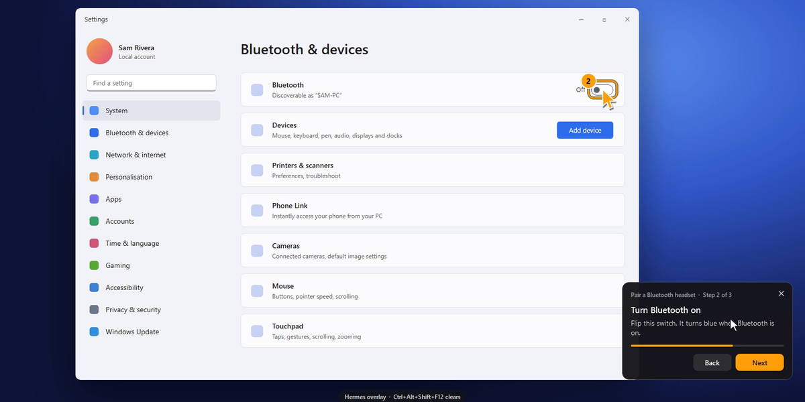
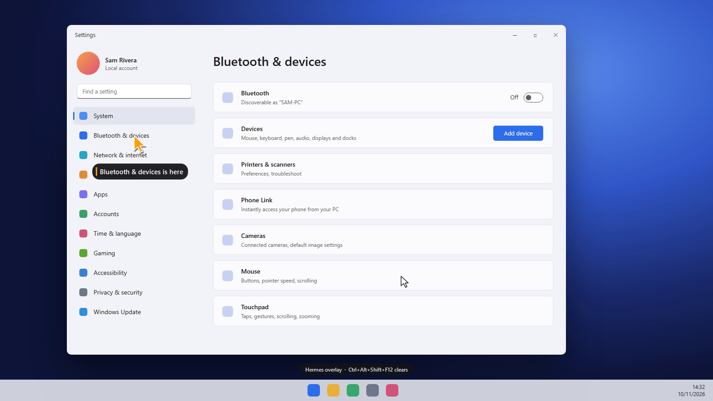
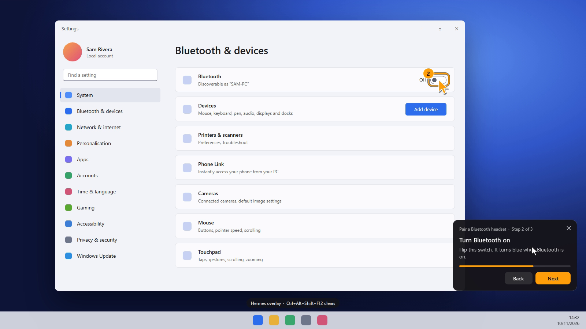
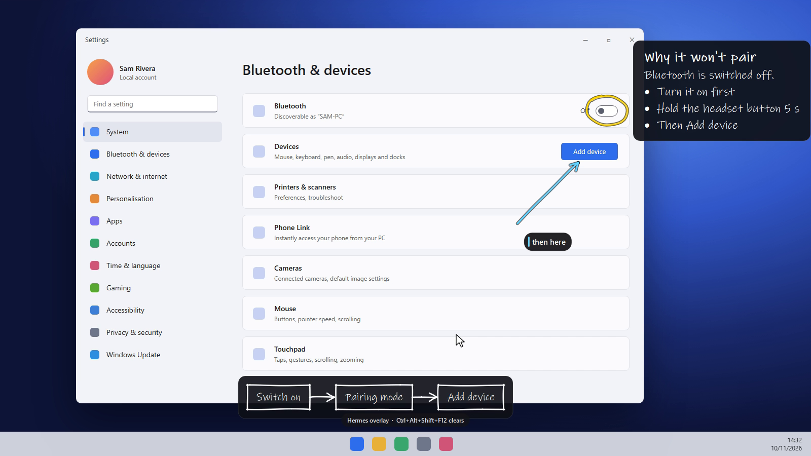
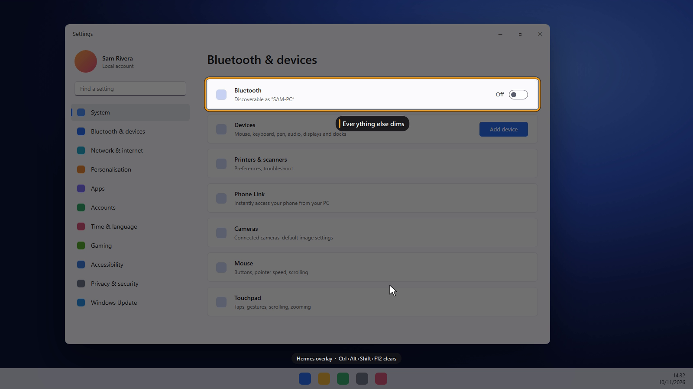

# screen-overlay



**Screen Overlay gives Hermes the ability to draw on your screen.**

Hermes could already tell you where something is. Now it can show you, on your real Windows
desktop, over whatever app you have open. Ask "where do I turn on Bluetooth?" or "why did my deploy
fail?" and Hermes glides a drawn pointer to the exact control or line, walks you through the steps
on a small floating panel, and writes notes and diagrams beside your work. You still do the
clicking.

- **A pointer that shows you.** A drawn pointer glides from where you are to the target and pulses.
  It never moves your real mouse.
- **Step guide.** A floating panel shows one step at a time, with Next and Back. The pointer moves to
  each step, the mark follows its window if it moves, and a step can wait for something that isn't on
  screen yet. Guides can be saved and replayed without asking the model again.
- **Glass notes.** Handwritten notes, circles, underlines, arrows and small flow diagrams write
  themselves on top of whatever you're doing, and you can click straight through them.
- **Sticky notes.** Paper notes Hermes leaves on your screen that are yours to keep: drag them
  anywhere, double-click to edit, close them with the ×. Hermes can read back what you wrote, so a
  note works as a small shared scratchpad. They stay until you close them.
- **Pinned to real UI elements.** Targets are resolved through Windows UI Automation. In testing, the
  element bounds matched the true on-screen pixels exactly.
- **DPI- and multi-monitor-aware.** There is one overlay window per monitor, and drawing happens in
  physical pixels before conversion to each monitor's scale.
- **Never takes focus.** Marks are click-through. The guide panel and sticky notes take clicks, and
  Windows is told not to activate them, so you keep typing where you were. The one exception is a
  sticky note you choose to edit: it takes the keyboard until you press Esc or Ctrl+Enter or click
  away, then hands it back to the app you were in. The overlay only covers
  monitors that have marks on them, and the pointer never crosses onto another monitor.
- **Emergency clear: `Ctrl+Alt+Shift+F12`.** Wipes every mark and stops the overlay process. A small
  hint chip shows this shortcut whenever marks are on screen.
- **Clears itself.** Marks expire (5 minutes by default), guides end after 30 idle minutes, and both go
  away when their Hermes session is closed.
  Sticky notes are the exception: they stay until you close them, Hermes removes them by name, or
  you press the emergency shortcut. The overlay process exits after 10 idle minutes with nothing on
  screen.

## What it looks like

| | |
|---|---|
|  |  |
|  |  |

These pictures were drawn by the plugin's own drawing code over a staged Settings window
(`exclude_from_capture` keeps the live overlay out of screenshots by default).

## Requirements

- Windows 10 2004+ or Windows 11.
- Hermes `>=0.22.0`.
- Python packages: `PySide6-Essentials>=6.7,<7` and `comtypes>=1.2,<2`. Hermes asks for consent before
  installing them. **PySide6 is about 215 MB on disk.**

## Install

```bash
hermes plugins install screen-overlay --enable
```

Before it is listed in the catalog, install from the repository instead:
`hermes plugins install tuancookiez-hub/hermes-screen-overlay --enable`.

Accept the dependency prompt, then start a new session. During development you can instead link a
checkout into `%LOCALAPPDATA%\hermes\plugins\screen-overlay` and run
`hermes plugins enable screen-overlay`.

## What Hermes gets

**Tool `screen_overlay`.** One tool with ten actions:

| action | does |
|---|---|
| `inspect` | `screens` (monitors, scale, work areas), `windows` (visible apps), `element_at` (UI element under a point), `find` (UI elements in a window by name, control type or automation id) |
| `show` | draws `pointer`, `step`, `spotlight`, `box`, `arrow`, `label`, `note`, `ink` and `flow` on `element`, `window`, `rect` or `point` targets. `note` and `flow` can find their own clear spot. Screenshot coordinates are rescaled when `space` is given. |
| `guide` | starts a step guide from `steps`, or replays a saved one with `guide_name`. `save_as` keeps it. |
| `guide_move` | `next`, `back` or a step number |
| `sticky` | leaves paper `notes` (text, optional title, colour and target) that the user can drag and edit. Reusing an id rewrites that note where it is. Up to 12 at once. |
| `stickies` | lists the notes on screen: current text, whether the user edited or moved each, and where it is |
| `guides` | lists saved guides, or removes one with `delete` |
| `clear` | removes all marks and any guide, or only some marks by `id` |
| `status` | what is on screen, the guide's current step, layer geometry, settings |
| `stop` | ends the overlay process |

Every result is JSON. A target that can't be resolved returns a reason and a hint, and the other marks
in the same call are still drawn.

Example:

```json
{"action": "show", "shapes": [
  {"type": "spotlight", "target": {"element": {"window": "Settings", "name": "Bluetooth & devices"}},
   "text": "Open Bluetooth & devices"}
]}
```

**Skill `screen-overlay:screen-overlay`** explains when to use the tool, the order to prefer targets
in, and worked examples.

**Slash command `/overlay clear|status|stop|next|back`** is your manual escape hatch.

**Hook `on_session_finalize`** removes a session's marks when it is closed, without touching marks from other chats.

## Settings

Settings are under Desktop → Settings → Plugins → screen-overlay, or `plugins.entries.screen-overlay.settings`:

| key | default | meaning |
|---|---|---|
| `exclude_from_capture` | `true` | Hide the overlay from screenshots and screen recordings, including Hermes' own, so the agent never mistakes its marks for app UI. Turn this off to record a demo. |
| `default_ttl_seconds` | `300` | How long marks stay up when a call doesn't set `ttl_seconds`. `0` keeps them until cleared. |
| `idle_exit_minutes` | `10` | How long the overlay process waits with nothing on screen before exiting. Minimum 1. |

## Disclosures

- **Background process.** The first `show` or `inspect` starts one detached Python process: the overlay
  daemon, run by Hermes' own interpreter. It exits when you press `Ctrl+Alt+Shift+F12`, when Hermes
  calls `stop`, or after `idle_exit_minutes` with nothing on screen (an open sticky note counts as
  something on screen, so the process stays up while one is open). Only one runs per Hermes profile,
  enforced by a named mutex.
- **Network.** None. Hermes and the daemon talk over a local Windows named pipe,
  `\\.\pipe\hermes-screen-overlay-<hash>`, authenticated with a random key.
- **What it reads.** Monitor layout, and titles, process names and bounds of visible top-level windows.
  It also reads UI Automation names, types and bounds of elements in the window you target. **These
  appear in tool results, so they are sent to whatever model Hermes is using.** It does not read
  window contents beyond those element properties, take screenshots, log keystrokes, or read any
  credential or config file.
- **What it writes.** Only to `<HERMES_HOME>/plugin-data/screen-overlay/`:
  - `ipc.key`: the pipe key
  - `daemon.pid`
  - `daemon.log`: rotated at 256 KB
  - `daemon.stderr.log`
  - `guides/<name>.json`: guides saved with `save_as`, with their step text and targets. These stay
    until removed with the `guides` action.

  Separately, `comtypes` caches its generated UI Automation bindings inside its own package folder the
  first time it runs (its standard behaviour).
- **System changes.** It registers the global hotkey `Ctrl+Alt+Shift+F12` while the daemon runs. If
  another app already owns that hotkey, the chip says so and you clear with `/overlay clear` instead.
  It changes no settings, installs no services or scheduled tasks, and does not update itself. It
  never moves the mouse or types.
- **Background work during a guide.** While a guide is open, the daemon looks up the current step's
  target about once a second through UI Automation, and backs off for apps that answer slowly.
- **Costs.** No paid APIs. The overlay process uses about 150 to 200 MB of RAM while running.

## Limits

- Windows only. On other platforms the tool is hidden.
- It can't draw over exclusive-fullscreen games, and may sit under apps that force themselves on top.
- UI Automation is blocked for apps running as administrator and for some protected apps, such as games
  with anti-cheat. Use a `window` or `rect` target for those.
- Only the current guide step follows its window. Marks from `show` stay where they were drawn, so
  call `show` again if a window moves.
- Marks are drawn on top of everything, so one can sit over a window that has since been covered.
- Hermes isn't told when you click Next. It sees your progress the next time it checks `status`.

## Development

```bash
python -m pytest -q -c tests/pytest.ini tests
```

```bash
hermes plugins validate .
```

```bash
hermes plugins doctor --ci .
```

`spikes/` holds the feasibility harness (`run.py`) and live checks (`e2e.py`, `focus_test.py`,
`guide_test.py`). All of them draw on screen and need PySide6, comtypes, pillow, numpy and psutil. `spikes/FINDINGS.md` records the
Tk vs PySide6, DPI and accuracy results.

## License

MIT
